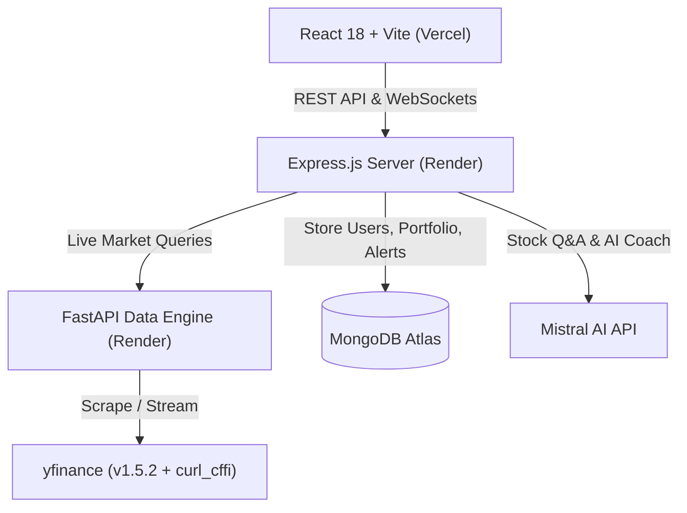

<div align="center">


# StockSense — AI-Powered Stock Analyzer & Assistant

**Professional-grade stock analytics for Indian NSE/BSE & Global markets**  
Built with MERN Stack + Python FastAPI + Mistral AI · Real-time · Open Source

<br/>

[](https://react.dev)
[](https://nodejs.org)
[](https://fastapi.tiangolo.com)
[](https://mistral.ai)
[](https://mongodb.com)
[](https://socket.io)
[](https://vercel.com)
[](https://render.com)

<br/>

> *"Not just another stock dashboard — StockSense tells you **why** the market moved,  
> scores your **trading psychology**, and explains every technical indicator **in plain English** using Mistral AI."*

</div>

---

## ✨ What Makes StockSense Different

Most stock platforms show raw price tables. StockSense provides actionable intelligence:

| Feature | Generic Apps | StockSense |
|---|---|---|
| Real-time prices | ✅ | ✅ (Socket.io live broadcast every 15s) |
| Technical indicators | ✅ | ✅ + **Mistral AI Live Indicator Explainer** |
| AI price forecast | ❌ / Paid | ✅ Built-in 6-factor composite prediction + Prophet |
| **Natural language Q&A** | ❌ | ✅ Powered by **Mistral AI** with live context |
| **Trading psychology score** | ❌ | ✅ Loss aversion, overtrading, impulsivity metrics |
| **Contextual AI Explainer** | ❌ | ✅ Explains what RSI/MACD means *right now* for *your stock* |
| NSE + BSE + Global | ❌ | ✅ |
| Custom Design System | Generic Tailwind | ✅ Warm earth-tone palette + 300ms Dark/Light crossfade |

---

## 🚀 Key Features Overview

<details>
<summary><strong>📊 Live Stock Analysis & Technical Engine</strong></summary>

- **Interactive charts** — Candlestick, Line, Area with volume overlay & smooth zooming
- **7 timeframes** — 1D · 5D · 1M · 3M · 6M · 1Y · 5Y
- **Live prices** via Socket.io — real-time WebSocket ticker updates
- **Technical indicators** — RSI (14), MACD, Bollinger Bands, EMA (9/20/50), SMA (200), Stochastic (%K/%D), ATR, VWAP
- **Consensus signal engine** — Combines 6 technical indicators into a unified `BUY`, `SELL`, or `HOLD` verdict
- **Full fundamentals** — P/E ratio, EPS, Profit Margins, Revenue Growth, Market Cap, 52-Week Range
- **Live news feed** — Sentiment tagging (Positive / Neutral / Negative) with article thumbnails

</details>

<details>
<summary><strong>🤖 Natural Language Stock Q&A (Mistral AI)</strong></summary>

Ask anything about any stock in plain English:

- *"Why did RELIANCE move today?"*
- *"Is TCS a good buy right now?"*
- *"What do the technical indicators say about AAPL?"*
- *"What are the key risks for Bajaj Finance?"*

Mistral AI fetches **live quotes, technical indicators, news, and fundamentals** in parallel before answering — every response is backed by current market data.

</details>

<details>
<summary><strong>🧠 AI Price Prediction & Factor Analysis</strong></summary>

Two prediction modes built right in:

1. **Built-in Composite Factor Model (No API cost)**:
   Combines 6 technical factors into a composite signal:
   - Linear regression trend (90-day slope)
   - Price momentum (5d / 20d / 60d returns)
   - RSI signal (oversold/overbought zones)
   - MACD crossover direction
   - Volume trend confirmation
   - EMA crossover (20 vs 50-day golden/death cross)

2. **Facebook Prophet (Optional ML forecasting)**:
   Uses time-series machine learning with 80% confidence intervals and seasonality detection.

Supports 7, 14, 30, 60, and 90-day forecast horizons.

</details>

<details>
<summary><strong>📈 Trading Psychology Score & AI Coach</strong></summary>

Analyzes your trade history and computes 5 key behavioral metrics:

| Metric | What it measures |
|---|---|
| **Loss Aversion** | Ratio of hold time for losing trades vs winning trades |
| **Overtrading** | Monthly trade frequency vs healthy benchmarks |
| **Impulsivity** | Percentage of trades closed in under 3 days |
| **Disposition Effect** | Selling winners too early while holding losing trades |
| **Risk Discipline** | Achieved Risk/Reward ratio across all completed trades |

Includes a **Mistral AI Coach Report** that generates a personalized 5-paragraph behavioral audit.

</details>

<details>
<summary><strong>💡 Live Indicator Explainer</strong></summary>

Every technical indicator card features an **✨ AI** button. Clicking it calls Mistral AI to give a 3-4 sentence breakdown:
1. What the indicator is saying **right now** for the stock
2. What this level historically means
3. What key signal or crossover level to watch next

</details>

<details>
<summary><strong>🌍 Global Market Overview & Sector Heatmaps</strong></summary>

- **10 Global Indices** — NIFTY 50, SENSEX, NIFTY BANK, S&P 500, NASDAQ, DOW, FTSE 100, Nikkei 225, Hang Seng
- **Sector Heatmap** — NSE sectors + US ETF performance
- **Top Gainers & Losers** — Live rankings across Indian & Global markets

</details>

<details>
<summary><strong>💼 Portfolio, Watchlist & Price Alerts</strong></summary>

- **Portfolio Tracker** — Record BUY/SELL trades, track real-time P&L, average buy price, and overall returns.
- **Price Alerts** — Set above/below price triggers with email notifications via Gmail SMTP (Nodemailer) and in-app Socket.io alerts.

</details>

---

## 🏗️ Architecture & Tech Stack



| Layer | Technology | Description |
|---|---|---|
| **Frontend** | React 18, Vite, TailwindCSS | High-performance SPA with custom theme token system |
| **Charts** | ApexCharts (`react-apexcharts`) | Interactive Candlestick, Area, Line, and Volume charts |
| **Backend API** | Node 20, Express.js, Socket.io | JWT auth, proxy routes, real-time alert broadcasts |
| **Data Microservice** | Python 3.10+, FastAPI, Uvicorn | Live quotes, technical indicators, news parser |
| **Data Sources** | `yfinance` 1.5.2 + `curl_cffi` | Bypasses rate-limiting for live NSE/BSE & US stock data |
| **AI LLM Engine** | Mistral AI API (`mistral-small-latest`) | Contextual Stock Q&A, Psychology Roast, Indicator Explainer |
| **Database** | MongoDB Atlas / Mongoose | Document storage for users, watchlists, portfolio, alerts |
| **Deployment** | Vercel + Render + Docker | Zero-downtime free cloud hosting architecture |

---

## 📁 Project Structure

```text
StockSense/
├── python-service/                 # FastAPI Market Data Microservice (Port 8000)
│   ├── main.py                     # Quotes, indicators, live prices, news, predictions
│   ├── requirements.txt            # FastAPI, uvicorn, yfinance, curl_cffi, pandas
│   └── Dockerfile
│
├── server/                         # Express.js Backend API (Port 5000)
│   ├── models/                     # User, Portfolio, Watchlist, Alert schemas
│   ├── routes/                     # Auth, Stocks, Market, News, Psychology, QA
│   ├── socket/                     # Socket.io live price & alert background engine
│   ├── middleware/                 # JWT Authentication guard
│   ├── .env                        # Production environment configuration
│   ├── index.js                    # Server entrypoint
│   └── Dockerfile
│
└── client/                         # React 18 Frontend SPA (Port 5173 / Port 80)
    ├── src/
    │   ├── pages/                  # Dashboard, StockDetail, StockQA, Psychology, Market
    │   ├── components/             # StockChart, IndicatorsPanel, IndicatorExplainer
    │   ├── context/                # AuthContext, ThemeContext
    │   ├── services/               # Axios API client, Socket.io connection manager
    │   └── App.jsx
    ├── index.html
    └── vite.config.js
```

---

## ⚡ Local Quickstart Guide

### Prerequisites
- **Node.js** v18+
- **Python** 3.10+
- **MongoDB** (Local instance or MongoDB Atlas URI)

### 1. Clone & Set Up Python Service
```bash
cd python-service
pip install -r requirements.txt
python main.py
# → Python Service running on http://localhost:8000
```

### 2. Set Up Express Backend
```bash
cd ../server
npm install

# Create server/.env file
cat <<EOT > .env
PORT=5000
NODE_ENV=development
CLIENT_URL=http://localhost:5173
MONGO_URI=mongodb://127.0.0.1:27017/stocksense
PYTHON_SERVICE_URL=http://localhost:8000
MISTRAL_API_KEY=your_mistral_api_key_here
MISTRAL_MODEL=mistral-small-latest
JWT_SECRET=ss_dev_secret_key_12345
EOT

npm run dev
# → Backend API running on http://localhost:5000
```

### 3. Set Up React Frontend
```bash
cd ../client
npm install
npm run dev
# → Client running on http://localhost:5173
```

Open **`http://localhost:5173`** in your browser to start using StockSense.

---

## 🐳 Docker Deployment

Run the complete 4-container stack (MongoDB, Python Service, Express API, Nginx Client) with a single command:

```bash
docker-compose up --build -d
```

Access the app at `http://localhost:5173`.

---

## 🌐 Free Cloud Deployment (Render + Vercel + MongoDB Atlas)

### Step 1: MongoDB Atlas Database
1. Create a free **M0 Cluster** on [MongoDB Atlas](https://www.mongodb.com/cloud/atlas).
2. Set Network Access to allow `0.0.0.0/0`.
3. Copy your connection URI (`mongodb+srv://...`).

### Step 2: Python Service on Render
1. Create a **Web Service** on [Render](https://render.com) pointing to `python-service`.
2. **Runtime**: `Python 3`
3. **Build Command**: `pip install -r requirements.txt`
4. **Start Command**: `uvicorn main:app --host 0.0.0.0 --port $PORT`

### Step 3: Express Backend on Render
1. Create a **Web Service** on Render pointing to `server`.
2. **Runtime**: `Node`
3. **Build Command**: `npm install`
4. **Start Command**: `node index.js`
5. **Environment Variables**:
   - `PORT` = `5000`
   - `NODE_ENV` = `production`
   - `MONGO_URI` = *Your MongoDB Atlas string*
   - `PYTHON_SERVICE_URL` = *Your Render Python service URL*
   - `MISTRAL_API_KEY` = `your_mistral_api_key_here`
   - `MISTRAL_MODEL` = `mistral-small-latest`
   - `JWT_SECRET` = `your_jwt_secret`

### Step 4: React Frontend on Vercel
1. Import repository on [Vercel](https://vercel.com).
2. **Framework Preset**: `Vite`
3. **Root Directory**: `client`
4. **Environment Variables**:
   - `VITE_API_URL` = `https://your-backend.onrender.com/api`
   - `VITE_SERVER_URL` = `https://your-backend.onrender.com`

---

## 🇮🇳 Indian & Global Stock Symbol Guide

| Market / Exchange | Symbol Suffix | Example Tickers |
|---|---|---|
| **NSE (India)** | `.NS` | `RELIANCE.NS` · `TCS.NS` · `HDFCBANK.NS` · `TATAMOTORS.NS` |
| **BSE (India)** | `.BO` | `RELIANCE.BO` · `INFY.BO` · `SBIN.BO` |
| **US / Global** | *(none)* | `AAPL` · `MSFT` · `NVDA` · `TSLA` · `GOOGL` |

---

## 📄 License

Distributed under the **MIT License**. Free for personal and commercial use.

---

<div align="center">

Crafted with ❤️ by **Atharva**

*StockSense is built for educational & informational purposes. Not financial advice.*

</div>